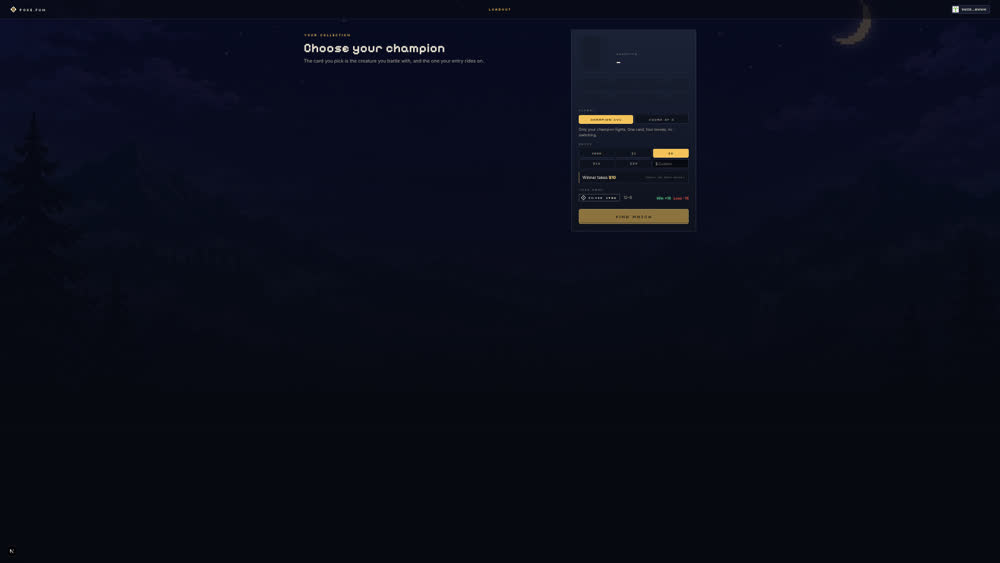
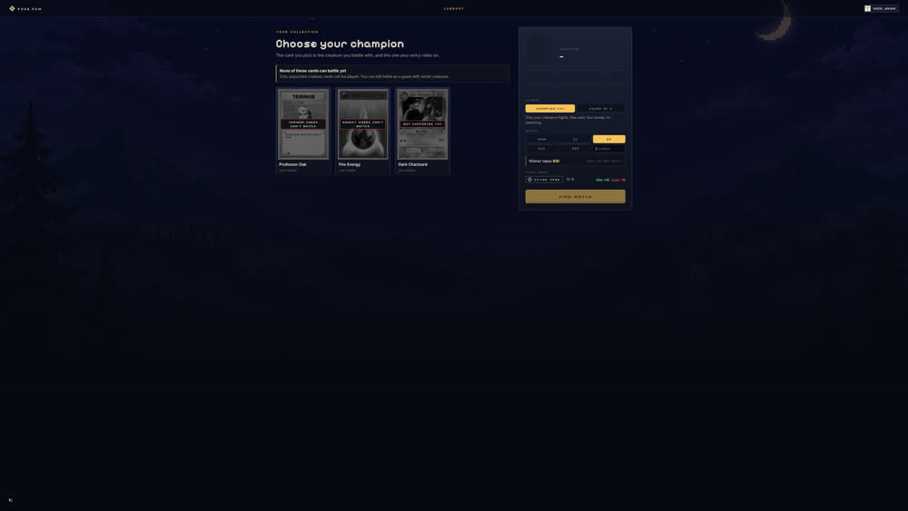
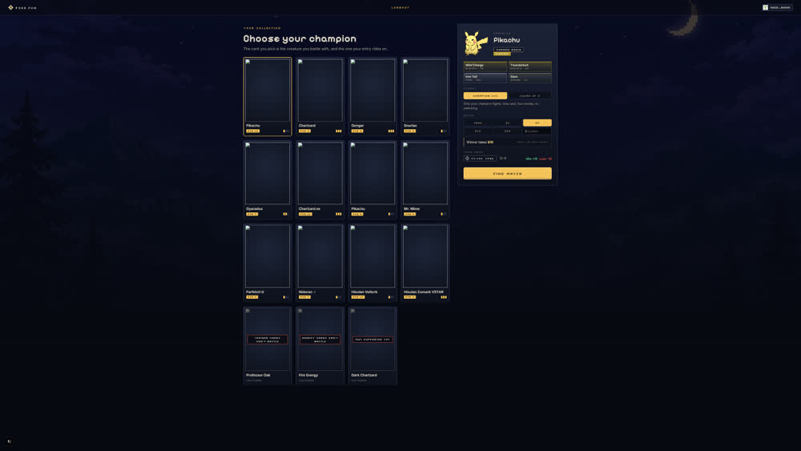
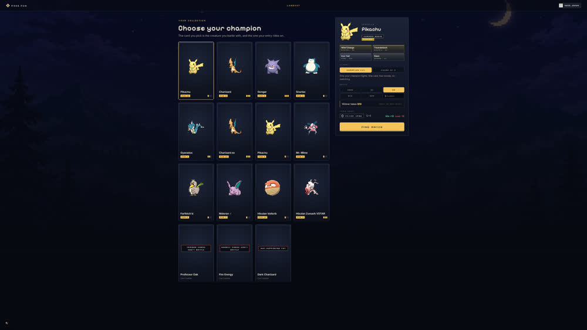
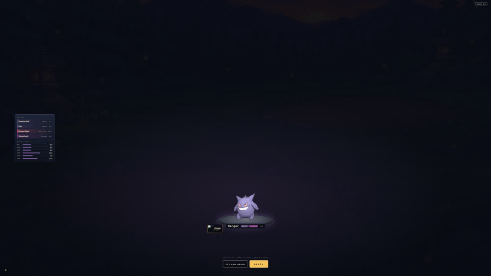
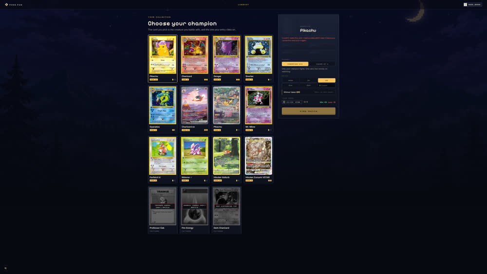
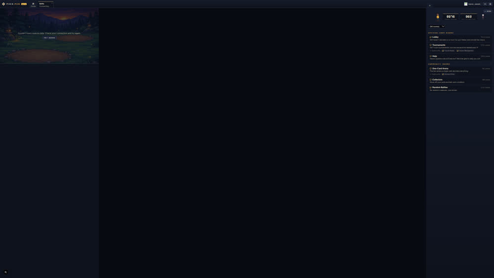
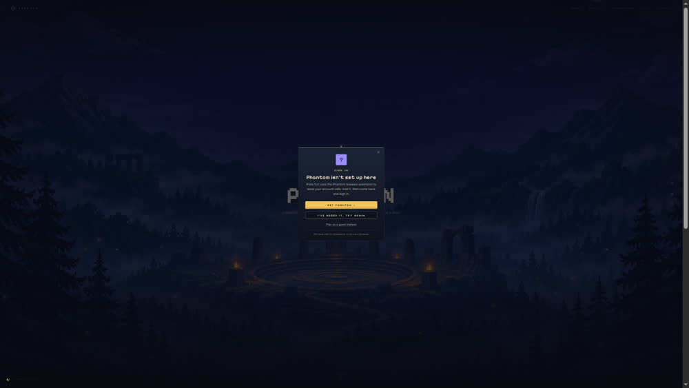

# Poke.fun frontend QA report

Scope: `apps/web` on branch `devin/1794673010-landing-battle-ui`, run with mocks via `npm run dev`. Routes: `/`, sign-in dialog, `/loadout`, matchmaking, `/battle`, `/play`, `/dev/summons`. Desktop Chrome at 1280×800 and 1600×900, driven by a scripted Playwright walk-through plus manual review of screenshots. Phantom was simulated with three stub wallets: approves, rejects, and not installed.

- **Pass 1:** the walk-through before any fixes.
- **Pass 2:** the same walk-through after the fixes.
- **Pass 3:** a targeted re-check of the follow-up fixes made after pass 2.

Severity: **blocker** (the app is unusable), **major** (a core flow is broken or misleading), **minor** (rough edge, workaround exists), **polish**.

## Summary

| Severity | Found in pass 1 | Fixed | Deferred | Still open |
|---|---|---|---|---|
| Blocker | 1 | 1 | 0 | 0 |
| Major | 4 | 4 | 0 | 0 |
| Minor | 8 | 5 | 3 | 0 |
| Polish | 2 | 1 | 1 | 0 |

No blockers or majors remain. Pass 2 had no page errors. The only console messages left are failed network requests that the tests caused on purpose: PokéAPI or the card-image site blocked, and `/play`'s Go API at `localhost:8080`, which is not part of this frontend.

## Issues

### QA-01 · Blocker · Blocked or full browser storage crashes every page
- **Where:** all routes.
- **Steps:**
  1. Block site data, or make `localStorage` throw (as in Safari private mode or with strict privacy settings).
  2. Open `/`.
- **Expected:** the site works. Settings are kept only for the current visit.
- **Actual (pass 1):** every route shows Next's "This page couldn't load".
- **Fix:** added `lib/storage.ts`, a wrapper that never throws and falls back to memory. It is now used by the wallet session, mute, Pause motion, rank, the PokéAPI cache, the mock collection, the match ticket and `/play`.
- **Pass 2:** fixed. Landing and Loadout render, and guest play works.

### QA-02 · Major · A stale or half-written match ticket crashes `/battle`
- **Where:** `/battle`.
- **Steps:**
  1. Set the `pf:match:v1` session storage entry to `{"matchId":"x"}`, which is what an old build would leave behind.
  2. Open `/battle`.
- **Expected:** you are sent back to the Loadout.
- **Actual (pass 1):** a page error (`Cannot read properties of undefined (reading 'team')`) and a crash screen.
- **Fix:** `isTicket()` in `MatchmakingService` checks the ticket's shape. A ticket that fails the check is deleted and `/battle` redirects to `/loadout`. Invalid JSON was already handled.
- **Pass 2:** fixed.

### QA-03 · Major · The custom entry accepts amounts that can't be played
- **Where:** `/loadout`, the Entry "Custom" field.
- **Steps:** type `0`, `-5`, `abc`, `0.005`, `1000` or `5.5.5`, or paste `$20 please`.
- **Expected:** amounts from $1 to $100 with at most 2 decimals. Anything else shows a clear message and cannot be used to find a match.
- **Actual (pass 1):**
  - `0.005` was accepted and the page said "Winner takes $0.02".
  - `1000` stayed in the field but $100 was used without saying so.
  - `0` silently kept the previous amount.
  - `5.5.5` was accepted.
- **Fix:**
  - The field now strips anything that isn't a digit or a dot and keeps at most 2 decimals.
  - Amounts outside $1–$100 show an inline message ("Minimum entry is $1" / "Maximum entry is $100").
  - While the message is shown, the "Winner takes" line is hidden and Find match is disabled.
  - Pasted `$20 please` becomes `20`.
- **Pass 2:** fixed (`0.005` becomes `0.00` plus the minimum message; `5.5.5` becomes `5.55`).

### QA-04 · Major · Dialogs and overlays don't trap keyboard focus
- **Where:** sign-in dialog, matchmaking overlay, full-screen summon.
- **Steps:** open the sign-in dialog and press Tab repeatedly.
- **Expected:** focus cycles inside the dialog, and Escape closes it.
- **Actual (pass 1):** after 3 presses, focus moved to the page behind the dialog.
- **Fix:** added a shared `lib/useFocusTrap.ts`, used by all three. Focus returns to whatever had it before the dialog opened.
- **Pass 2:** fixed. 8 Tab presses all stayed inside the dialog, and Escape closes it.

### QA-05 · Major · Switching the Phantom account mid-session keeps the old account
- **Where:** all signed-in routes.
- **Steps:**
  1. Sign in.
  2. Switch the account in Phantom (some wallet versions do this without sending an event).
  3. Come back to the tab.
- **Expected:** you are signed out and asked to sign in again with the new account.
- **Actual (pass 1):** the old address stayed in the header, and its cards and rank stayed on screen.
- **Fix:** `WalletProvider` checks `provider.publicKey` against the session on load, on window focus and when the tab becomes visible. This is on top of the existing `accountChanged` listener.
- **Pass 2:** fixed. You are signed out and the sign-in dialog opens.

### QA-06 · Minor · Empty or all-ineligible collection is a dead end
- **Where:** `/loadout` with the mock collection set to `empty` or `ineligible` (from `/dev/summons`).
- **Expected:** a short explanation and a way to keep playing.
- **Actual (pass 1):** an empty grid (or only greyed-out cards) and a disabled Find match button, with no explanation.
- **Fix:** an explanation banner with a "Battle as a guest" button.
- **Pass 2:** fixed.

 

### QA-07 · Minor · Card art shows broken-image icons when the card image site is down
- **Where:** `/loadout` grid.
- **Steps:** block `images.pokemontcg.io`, then open `/loadout`.
- **Expected:** a readable placeholder.
- **Actual (pass 1):** an empty frame with the browser's broken-image icon.
- **Fix:** `CardArt` falls back to the creature's sprite, or to "Card art unavailable" if there is no sprite. The summon already fell back to a stand-in card and completes; see the pass 2 screenshot.
- **Pass 2:** fixed.

  

### QA-08 · Minor · Picking a card while PokéAPI is down gives no feedback
- **Where:** `/loadout`.
- **Steps:** block `pokeapi.co`, clear the `pf:cache` entries, then pick a card.
- **Expected:** a message explaining why nothing happened.
- **Actual (pass 1):** the summon closed immediately.
- **Fix:** an alert reading "Couldn't wake this card…". Find match stays disabled until the data loads.
- **Pass 2:** fixed.

### QA-09 · Minor · A ticket with an unknown creature offers a pointless "Try again"
- **Where:** `/battle`.
- **Actual (pass 1):** "Couldn't load creature data… Try again". Retrying can never work, because PokéAPI returns 404 for that creature.
- **Fix:** a 404 now shows "This match uses a creature we can't load" with a "Back to loadout" button. Tickets with empty teams are rejected before loading (see QA-02).
- **Pass 3:** fixed.

### QA-10 · Polish · Chat has no rate limit
- **Where:** `/battle` chat.
- **Steps:** send 25 messages quickly. (Very long messages were already capped at 300 characters and don't scroll sideways.)
- **Fix:** sends from the same player are limited to one every 600 ms. A blocked send shows the notice "You're sending messages too fast".
- **Pass 2:** fixed (25 sends produced 2 messages).

### QA-11 · Minor · Deferred · Refreshing during the countdown drops the match
- **Steps:** Find match, then reload the page while "Match found" is counting down.
- **Actual:** you're back on the Loadout and the match is gone.
- **Why deferred:** there is no real match yet. When the backend's MatchmakingService exists, the frontend should restore the search from the server's ticket instead of keeping it only in the page.

### QA-12 · Minor · Deferred · Leaving mid-battle and coming back restarts the mock battle
- **Steps:** during a battle, go to `/`, then back to `/battle`.
- **Actual:** turn 1 again. The mock also takes the entry a second time.
- **Why deferred:** resuming needs the real BattleStreamSource, which owns battle state on the server. The mock has nothing to resume from.

### QA-13 · Polish · Deferred · A second tab sends you to the Loadout
- **Steps:** open `/battle` in a second tab.
- **Actual:** a redirect to `/loadout`. Match tickets are stored per tab, so the second tab has none.
- **Why deferred:** this is intended until server-side match IDs exist. A future version could show "This match is open in another tab".

### QA-14 · Minor · Deferred · Large collections have no search
- **Where:** `/loadout` with the `large` mock collection (439 cards).
- **Actual:** the page renders in about 2.9 s including data loading. Card art loads lazily as you scroll. There is no search or filter.
- **Why deferred:** real wallets in the demo hold only a few cards. The `/dev/summons` gallery's set filter and search can be copied over when needed.

## Checklist coverage (pass 2 results)

| Area | Check | Result |
|---|---|---|
| Users | First-time visitor sees landing → Play → sign-in | OK |
| Users | Returning signed-in user is remembered after reload | OK |
| Users | Guest gets the rental pool and free matches only | OK |
| Users | Phantom not installed → "Get Phantom" / "Play as a guest" | OK  |
| Users | Sign-in cancelled → friendly retry | OK |
| Users | Account switched mid-session | Fixed (QA-05) |
| Collection | Empty / all ineligible / one eligible / large (439) | Fixed (QA-06), OK, OK, OK (QA-14 deferred) |
| Entry | 0, negative, letters, 0.005, above max, paste | Fixed (QA-03) |
| Matchmaking | Cancel search; double-click Find match | OK (one overlay) |
| Matchmaking | Refresh / Back during countdown | Back: no stray redirect. Refresh: QA-11 deferred |
| Matchmaking | `/battle` directly / in two tabs / stale or invalid ticket | Redirect to Loadout / QA-13 / fixed (QA-02) |
| Battle | Forced switch, rematch, cancel, timer | OK (forced switch and rematch were checked in earlier passes; the 150 s timer was checked by fast-forwarding time in the mock) |
| Battle | Leaving mid-battle | QA-12 deferred |
| Battle | Long chat messages, chat spam | OK / fixed (QA-10) |
| Battle | Mute and Pause motion kept after reload | OK |
| Network | PokéAPI offline | Fixed feedback (QA-08) |
| Network | Card image site offline | Fixed (QA-07) |
| Network | Blocked or full storage | Fixed (QA-01) |
| A11y | Keyboard-only landing tab order | OK: brand, nav, Sign in, CTA, socials, Pause motion |
| A11y | Focus trap in dialogs and overlays | Fixed (QA-04) |
| A11y | Screen-reader labels | Icon buttons, the entry field, card radios and dialogs all have labels. Alerts use `role="alert"` |
| A11y | Reduced motion (OS setting and Pause motion) | OK: the summon becomes a crossfade and send-out summons are skipped |
| A11y | Colour contrast | Body text and the amber button pass WCAG AA. The faint 11 px captions (`--text-faint`) are about 4.6:1 on `--ink-0` |
| Layout | Sideways scrolling at 1280 px on all routes | None |
| Summons | All 434 catalog cards in `/dev/summons` | Checked 201/201 species with no missing data. Full and mini summons were spot-checked across vintage, modern, full-art, Hisuian, Gigantamax and Mr. Mime cards |
